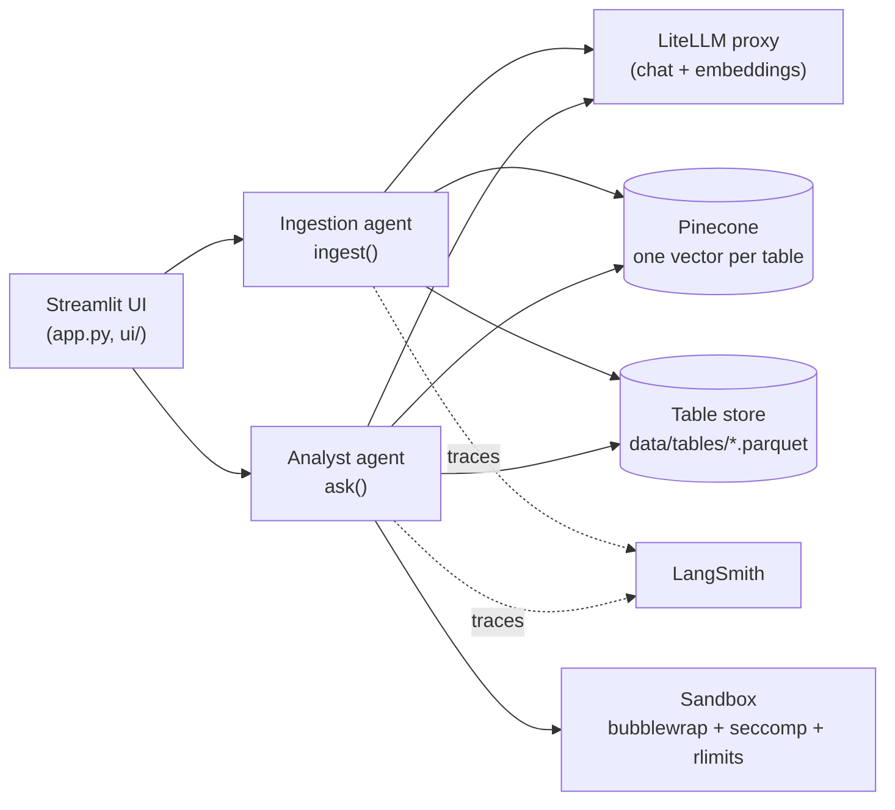
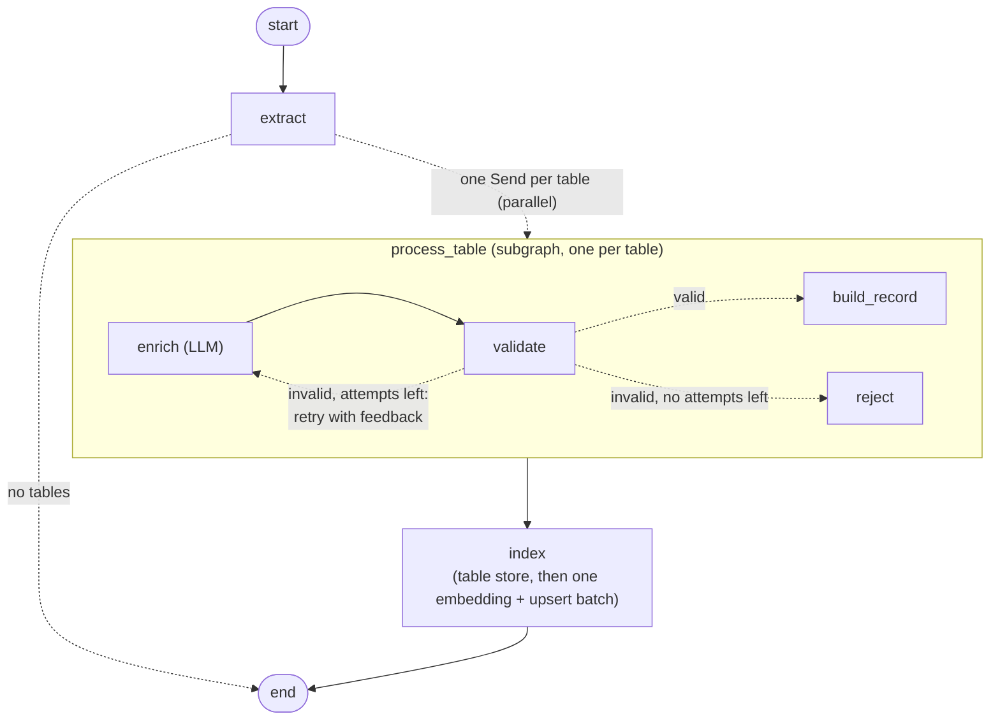
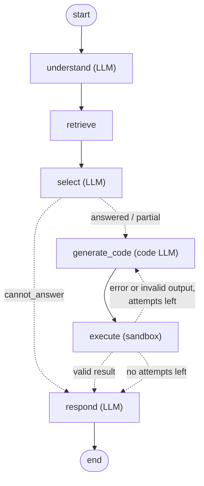

# PDF Tables QA: a multi-agent system over tables in PDFs

Two LangGraph agents and a Streamlit UI for asking questions about the tables inside PDF
reports:

- **Ingestion agent**: extracts every table from a PDF (merging tables that continue on
  the next page), has an LLM describe each one from its surrounding text, validates that
  description against the data (and sends it back to the LLM with feedback when it's
  wrong), then stores the data locally and indexes the description in Pinecone.
- **Analyst agent**: understands a question, finds the tables that can answer it (one or
  several), decides whether they really contain everything needed, writes a pandas
  program, runs it in a sandbox, corrects it if it fails, and answers. Every answer ends
  in `answered`, `partial` or `cannot_answer`, decided by code from the agent's judgements
  and the program's output, never invented.

Course assignment for *Sistemas Multiagente de IA* (ITBA). The specification is
[assignment.md](assignment.md).

**Evaluation report:** [EVALUATION.md](EVALUATION.md)

---

## Contents

1. [Setup and running](#1-setup-and-running)
2. [Repository layout](#2-repository-layout)
3. [Architecture](#3-architecture)
4. [Design decisions](#4-design-decisions)
5. [Tests](#5-tests)
6. [Known limitations](#6-known-limitations)
7. [Credits](#7-credits)

---

## 1. Setup and running

### Requirements

- [uv](https://docs.astral.sh/uv/) (it installs Python 3.14 itself).
- Accounts and keys: the LiteLLM proxy, a Pinecone project (free plan), and
  LangSmith (free plan).
- For the full code sandbox: Linux with **bubblewrap** (`bwrap`) and **libseccomp**
  (`libseccomp.so.2`). Both are standard on Fedora, Ubuntu and Debian
  (`sudo apt install bubblewrap libseccomp2` if missing). Without them the app still works,
  with reduced isolation, and says so in the sidebar (see [4.6](#46-sandboxing-the-generated-code)).

### Install

```bash
cp .env.example .env              # then fill in the keys (see the table below)
uv sync                           # the app's environment
uv sync --project sandbox         # the sandbox's separate, minimal environment
```

The Pinecone index (standard, dimension 1536, cosine) is created automatically on first
use; there's nothing to set up in the Pinecone console besides the API key.

### Configuration (`.env`)

| Variable | Required | Default | Purpose |
|---|:-:|---|---|
| `LITELLM_BASE_URL`, `LITELLM_API_KEY` | ✔ | | LiteLLM proxy; every LLM and embedding call goes through it |
| `LLM_MODEL` | | `gpt-4.1-mini` | Model for every LLM step except code generation |
| `LLM_CODE_MODEL` | | = `LLM_MODEL` | Model for the analyst's code generation (the hardest task) |
| `LLM_TEMPERATURE`, `LLM_CODE_TEMPERATURE` | | `0` | `none` doesn't send a temperature (some models, e.g. `claude-opus-4-8`, reject it) |
| `EMBEDDING_MODEL`, `EMBEDDING_DIMENSION` | | `text-embedding-3-small`, `1536` | |
| `PINECONE_API_KEY` | ✔ | | |
| `PINECONE_INDEX_NAME` | | `mas-2026s2-tables` | Created on first use (`PINECONE_CLOUD`/`PINECONE_REGION`: `aws`/`us-east-1`) |
| `LANGSMITH_TRACING`, `LANGSMITH_API_KEY`, `LANGSMITH_PROJECT` | ✔ | | Tracing of every agent run |
| `INGEST_MAX_ATTEMPTS`, `INGEST_MAX_CONCURRENCY` | | `3`, `4` | Metadata attempts per table; tables processed in parallel |
| `ANALYST_TOP_K`, `ANALYST_MAX_CANDIDATES`, `ANALYST_MAX_CODE_ATTEMPTS` | | `5`, `8`, `3` | Results per search; tables offered to the LLM; programs per question |
| `SANDBOX_TIMEOUT_S`, `SANDBOX_MEMORY_MB` | | `30`, `1024` | Limits for generated code (keep memory ≥ 1024, see [4.6](#46-sandboxing-the-generated-code)) |
| `DATA_DIR` | | `./data` | Table store and uploads |

### Run

```bash
uv run streamlit run app.py
```

1. **Upload PDFs**: upload your own, or click *Ingest the 2 sample PDFs*. Progress is
   shown live, table by table.
2. **Indexed tables**: browse what was indexed: description, columns with units, source
   pages, and the data.
3. **Ask**: ask in English or Spanish. Each answer shows its status, what data is missing
   (if any), how the question was understood, the selected tables, the generated code with
   its output and corrections, and the sandbox layers used.

Command-line versions of both agents (same code as the UI):

```bash
uv run python -m agents.ingestion.graph data/sample_pdfs/informe_anual_ferreteria_andina.pdf
uv run python -m agents.analyst.graph "¿Cuántos turistas llegaron en julio de 2024?"
```

Other commands:

```bash
uv run pytest                                  # tests (no network needed)
uv run python -m evaluation.evaluate           # run the test questions (needs the sample PDFs ingested)
uv run python scripts/sandbox_demo.py          # show what the sandbox allows and blocks
uv run python scripts/make_sample_pdfs.py      # regenerate the sample PDFs
uv run python scripts/explore_pdf.py <file>    # print what PyMuPDF sees in a PDF
uv run ruff check . && uvx pyright --pythonpath .venv/bin/python   # lint, strict type check
```

---

## 2. Repository layout

```
.
├── app.py                    # Streamlit entry point: settings check, sidebar, pages
├── ui/                       # one module per page: ask, upload, indexed tables
├── agents/
│   ├── ingestion/            # state, nodes, edges, graph, prompts, schemas, rules
│   └── analyst/              # same structure
├── services/
│   ├── config.py             # settings from .env (pydantic-settings)
│   ├── llm.py                # LangChain clients for the LiteLLM proxy
│   ├── pdf_extract.py        # PyMuPDF extraction, header flattening, continuation merging, context
│   ├── numbers.py            # parsing "1.234,5" / "1,234.5" / "$ (1.234)" / "12 %"
│   ├── table_store.py        # Parquet + JSON per table
│   ├── vector_store.py       # Pinecone index
│   └── sandbox.py            # running generated code in isolation
├── sandbox/                  # the sandbox's own uv environment and its launcher script
├── evaluation/               # test questions, evaluation runner, latest results
├── data/sample_pdfs/         # the two sample PDFs (fictional data)
├── scripts/                  # sample PDF generator, PDF explorer, sandbox demo
└── tests/
```

In `agents/*`, `rules.py` holds the deterministic logic (validation, ids, status, output
checks), so it can be unit-tested without an LLM; `nodes.py` holds the graph steps.

---

## 3. Architecture



The UI calls the agents only through `agents.ingestion.graph.ingest()` and
`agents.analyst.graph.ask()`, which take a progress callback; the command-line runners use
the same functions.

### Ingestion graph



- **extract** (no LLM): PyMuPDF → tables (continuations merged) → typed DataFrames +
  context (heading, caption, notes).
- **enrich** (LLM, structured output): name, description, column descriptions and units,
  which column labels the rows.
- **validate** (no LLM): checks the metadata against the DataFrame; the errors become the
  feedback for the next attempt.
- **build_record / reject** (no LLM): computes `table_id`, source pages and row labels; or
  reports the table as skipped.
- **index** (no LLM): runs once after all branches; saves, embeds and upserts the valid tables.

### Analyst graph



- **understand**: splits the question into independently answerable parts (metrics,
  entities, periods, operation) and writes one search per dataset needed, in Spanish and
  English.
- **retrieve** (no LLM): embeds all searches in one request, queries Pinecone with each,
  keeps each table's best score, drops tables whose data file is missing.
- **select**: per part, which candidate tables it needs and whether everything it needs is
  there (the §6.4 rules are in the prompt). Code then discards invented table ids and
  computes the status: all parts answerable → `answered`, none → `cannot_answer`, else
  `partial`.
- **generate_code**: a program over the selected tables, given their real column names
  and dtypes (read from the Parquet files), units, first rows, all row labels, and the
  packages available in the sandbox (with versions). On a retry: the failed program and
  its error.
- **execute** (no LLM): runs it in the sandbox and validates its output (one JSON line:
  one entry per part, each a value or the reason it's `missing`, no NaN). A part the program
  reports as missing becomes unanswerable, and the status is recomputed (it can only go down).
- **respond**: writes the answer from the computed values only; numbers are formatted and
  the tables/pages are cited by code.

Both graphs are exported by LangGraph with
`build_graph().get_graph(xray=True).draw_mermaid()`; the diagrams above are the same graphs
with labeled edges.

---

## 4. Design decisions

The principle throughout: **the LLM does what needs judgment, plain code does everything
deterministic** (parsing numbers, merging tables, ids, validation, status, number
formatting, citations), and that code is unit-tested.

### 4.1 PDF extraction: PyMuPDF

PyMuPDF has no external dependencies (no Java, no Ghostscript), and gives both the tables
(`find_tables`) and the positioned text blocks needed for context. Its raw output needs
work, done in `services/pdf_extract.py`:

- **Headers**: PyMuPDF treats the first row of every table as its header, which is wrong
  for a continuation without a repeated header. We use the raw rows (`extract()`), and the
  header is the leading rows that contain no numbers except years.
- **Multi-row headers / merged cells**: a merged cell comes back as `None` in the cells it
  covers; the text is copied across and the rows are joined (`2023` + `Unidades` →
  `2023 Unidades`).
- **Continuation tables**: merged when, as the spec defines, a table is the first on the
  next page, the previous one was the last on its page, the column counts match, and the
  header is either repeated (then dropped) or absent. All pages are kept in `source`.
- **Numbers**: everything comes out as text. Each table's decimal separator is inferred by
  letting its cells vote (`1.850.400` → thousands are `.`; `0,2` → decimals are `,`), then
  `parse_number` handles currency symbols, `%`, signs and accounting parentheses. Columns
  whose non-empty cells are all numbers become nullable `Int64`/`Float64` (empty cells are
  `<NA>`, not 0); a `%` column gets ` (%)` added to its name so the unit isn't lost.
- **Context**: the nearest heading above the table, the text between it (or the previous
  table) and the table, and up to two blocks after it (notes, sources). Text blocks inside
  any table are excluded; a 3-point tolerance handles captions whose box slightly overlaps
  the table.
- **Unreadable content**: pages without a text layer, and large images (which may hold a
  table), are skipped and reported in the UI.

### 4.2 Metadata: LLM for meaning, code for facts

The LLM fills in only what needs judgment (`TableMetadata`): name, 2–4 sentence
description, per-column description and unit, and *which* column labels the rows. Code
fills in the rest (`TableRecord`): `table_id`, source file and pages, the row labels
themselves (read from the data, never generated), row count and a preview.

`validate` checks: one entry per column, names identical and in order, the row-label column
exists and isn't numeric, name length, 2–4 sentences. Its messages are written as
instructions, and the next `enrich` call gets its previous answer plus those messages.
After `INGEST_MAX_ATTEMPTS`, the table is skipped with a warning rather than indexed with
wrong metadata. (A lesson from development: the first sentence counter split on "S.A.",
which no LLM rewrite could fix; a validation message must describe something the LLM can
change.)

Metadata is written in the language of the document's prose, not of the cell values.

Tables are processed **in parallel**: `extract` returns one `Send` per table, each running
the `process_table` subgraph with its own state; `operator.add` reducers collect records and
warnings in the parent state. `max_concurrency` caps simultaneous LLM calls. Per-table
progress is emitted as custom stream events, because parallel branches' updates don't say
which table they belong to.

### 4.3 Table store: Parquet + JSON per table

`data/tables/{table_id}.parquet` holds the data, keeping the nullable dtypes (CSV would
not); `{table_id}.json` holds the full record, used by the UI's table browser. Files are
written atomically (temporary file + rename). Table ids are validated before being used as
file names, since they come back from Pinecone at query time.

### 4.4 Embeddings and indexing: one vector per table, no chunking

Questions target tables, not passages, so each table is one record: no chunking. The
embedded text is `name + description + columns (name, unit, description) + up to 50 row
labels`: the subject, the measures and the entities a question mentions.

- **Metadata** (≤ 40 KB per record in Pinecone) holds everything table selection needs, so
  `select` never opens the table store: name, description, file, pages, columns (as JSON),
  row labels, row count, a 5-row preview. If a record would exceed the limit, row labels are
  trimmed first, then the preview.
- **Idempotency**: `table_id = sha256(PDF content)[:16] + "-p{first page}-t{index on page}"`.
  Re-ingesting the same PDF produces the same ids, and an upsert overwrites them
  (verified: 5 records before and after re-ingesting).
- **Order and batching**: `index` runs once, after all branches, with only the validated
  tables: it writes the table store first (a Pinecone record must never point to missing
  data), then makes one embedding request and one batched upsert.
- **Languages**: questions and documents may each be Spanish or English. Rather than
  translating metadata, `understand` writes every search in both languages and retrieval
  keeps each table's best score, so there's always a query in the document's language.

### 4.5 Analyst: answerability decided by code

The status isn't left to the final prose. `select` returns one yes/no per part with the
reason; `rules.decide_status` turns those into the status, stored in the graph state.
`execute` can lower it: the program reports `"missing"` for data it doesn't find, and
those parts become unanswerable. A question no part of which is answerable never reaches
code generation. If every program fails, the status becomes `cannot_answer` with
"the calculation failed after N attempts".

Code generation uses its own model setting (`LLM_CODE_MODEL`), since it's the hardest step.
Tested through the proxy with structured output: `gpt-4.1`, `gpt-5.4`, `gpt-5.4-mini`,
`claude-sonnet-4-5`, and `claude-opus-4-8` (with `LLM_CODE_TEMPERATURE=none`).

### 4.6 Sandboxing the generated code

Python can't sandbox code inside its own process (anything set up there can be undone), so
the program runs in a separate process that the **kernel** restricts before the code
starts. The design is a whitelist: the sandbox starts with nothing and gets only what it
needs.

1. **bubblewrap** (Linux namespaces): an empty filesystem with only `/usr`, the Python
   runtime and the sandbox's own packages (read-only) and a temporary folder with the
   program and copies of the selected tables. No network interfaces, no home folder, no
   project files, no `.env`; an empty environment (no API keys); no capabilities; no nested
   user namespaces.
2. **seccomp** (loaded by `sandbox/launcher.py` before the code runs, irreversible): sockets
   only of family `AF_UNIX`, no nested user namespaces, and ~30 risky system calls denied
   (`ptrace`, `bpf`, `io_uring`, `keyctl`, `mount`...). The socket rule also blocks the
   entry points of the 2026 kernel exploits "Copy Fail" (`AF_ALG`) and "Dirty Frag"
   (`AF_RXRPC`, IPsec netlink), which namespaces alone don't.
3. **Resource limits**: address space (1 GB), CPU time, file size (caps output too, since
   stdout goes to a file), process count, no core dumps; the whole sandbox is killed at the
   timeout (killing bubblewrap tears down its PID namespace).
4. **A separate environment** (`sandbox/pyproject.toml`): only numpy, pandas and pyarrow
   (plus pyseccomp for the launcher). None of the app's 120+ packages (LangChain, OpenAI,
   Pinecone...) are visible inside. The code-generation prompt lists exactly these
   packages and versions (`services.sandbox.available_packages()`).

Where bubblewrap or libseccomp aren't available, the remaining layers still apply
("reduced isolation", shown in the UI and in every result). `scripts/sandbox_demo.py`
demonstrates the layers; `tests/test_sandbox.py` tries to escape them (reading files
outside, network, `AF_ALG` sockets, user namespaces, memory, fork, infinite loops), each test
harmless even if the sandbox failed.

### 4.7 Observability

Every ingestion and analyst run is one LangSmith trace (`run_name` `ingestion` /
`analyst`, tags, metadata: file name or question, and `eval_id` for evaluation runs), with
every node as a span, including the nodes inside each parallel `process_table` branch.

---

## 5. Tests

`uv run pytest`: about 160 tests, none needing network or API keys (LangSmith tracing is
switched off in `tests/conftest.py`). They cover number parsing, header detection,
continuation merging, context, metadata validation, ids, Pinecone metadata size trimming,
the table store, retrieval merging, status decisions, result validation, both graphs end to
end with fake LLMs (including the retry, reject, self-correction and give-up paths; generated
programs run in the real sandbox), the sandbox's escape attempts, and the Streamlit pages
(headless, with Streamlit's `AppTest`). The code is type-checked with Pyright in strict mode.

The test questions with expected answers and statuses are in
[evaluation/questions.json](evaluation/questions.json); their results are in
[EVALUATION.md](EVALUATION.md).

---

## 6. Known limitations

**Extraction**
- Table detection relies on drawn ruling lines (PyMuPDF's default strategy). Tables laid out
  only with whitespace aren't detected.
- A cell merged *vertically* in the body comes out empty in the rows below it instead of
  being repeated.
- Header detection is a heuristic (leading rows without non-year numbers): a continuation
  page whose first data row is all text would be mistaken for a new table.
- Context stops at the nearest heading: an introduction above the first heading (e.g. "2024
  estimates weren't available") isn't attached to the table.
- No OCR: scanned pages and tables inside images are skipped (and reported).

**Indexing**
- Ids depend on the PDF's content: if a document changes, its new tables get new ids and the
  old records remain in Pinecone and the table store (there's no delete).

**Analyst**
- Answerability relies on the LLM's judgment in `select`; code enforces what it can (valid
  table ids, the program's `missing` reports) but can't verify, e.g., that a column is
  nominal rather than real.
- Each question is independent: the chat shows history, but follow-up questions don't see
  earlier ones.

**Sandbox**
- The memory limit is on address space, not memory used. pandas and pyarrow reserve
  ~600 MB of it, so the default 1 GB leaves ~400 MB for computation; pyarrow is switched
  to the system allocator and single-threaded BLAS to keep reservations down.
- When pyarrow can't allocate memory it hangs instead of failing; the timeout catches it,
  but the error then says "time limit", not "memory".
- Reduced mode (no bubblewrap) gives no filesystem or network isolation; seccomp still
  blocks sockets if libseccomp is present.
- The host kernel is shared: a bug in a system call the code is allowed to use (`read`,
  `mmap`...) could still allow an escape. Only a separate kernel (gVisor, a microVM) would
  close that, which is beyond this project.

**Evaluation**
- The sample PDFs and questions are synthetic and written by the same author as the system;
  see [EVALUATION.md](EVALUATION.md) for what that does and doesn't show.

---

## 7. Credits

- Built on the course's demo projects for structure and idioms (`demos/demo-langgraph` for
  the LangGraph module split; `demos/02-memory` for LiteLLM client setup; `demos/01-knowledge-part1`
  for the Streamlit app structure).
- LangGraph, LangChain, PyMuPDF, Pinecone, Streamlit, bubblewrap and libseccomp documentation.
- Developed with the help of an AI coding assistant (Claude Code), as the course rules
  allow; every part was reviewed and is explained in this document.
- The sample PDFs are generated by `scripts/make_sample_pdfs.py` with fictional data
  ("Ferretería Andina S.A." doesn't exist).
